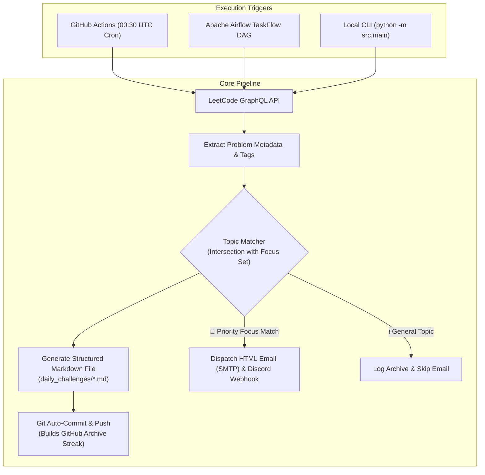

# 🚀 LeetPulse: Automated LeetCode POTD Pipeline & Smart Alerting Engine

[](https://python.org)
[](https://airflow.apache.org)
[](https://github.com/features/actions)
[](https://www.docker.com)
[](https://opensource.org/licenses/MIT)

> **LeetPulse** is a dual-mode automated data pipeline that queries LeetCode's GraphQL API daily, parses complex problem schemas, auto-archives formatted Markdown documents directly into your GitHub repository to maintain your streak, and intelligently evaluates problem topic tags against your customized target practice sets to dispatch priority HTML email and Discord alerts.

---

## 🌟 Key Features

* **🔄 Dual-Mode Architecture:** Run serverless on **GitHub Actions (0 server maintenance)** or orchestrate with **Apache Airflow (TaskFlow API)**.
* **🎯 Smart Topic Matcher:** Compares daily problem tags (`Dynamic Programming`, `Graph`, `Two Pointers`, `Binary Search`, etc.) against your target learning focus.
* **📧 Rich HTML Email & Webhook Alerts:** Dispatches styled HTML email cards via SMTP and Discord webhook embeds when focus topics match.
* **📝 Automated Git Problem Archiving:** Generates clean Markdown files with descriptions, tags, difficulty badges, and code starter stubs, auto-committing them to your repository daily.
* **🐳 1-Click Docker Deployment:** Includes `docker-compose.yaml` to spin up a standalone Airflow environment in seconds.

---

## 🏗️ System Architecture



---

## 📁 Repository Structure

```text
leetcode-pulse/
├── .github/
│   └── workflows/
│       └── leetcode-tracker.yaml   # GitHub Actions daily automated cron
├── dags/
│   └── notify_leetcode.py          # Apache Airflow DAG (TaskFlow API)
├── src/
│   ├── __init__.py
│   ├── config.py                   # Focus topics & environment variables
│   ├── leetcode_client.py          # GraphQL query client & topic matching
│   ├── markdown_builder.py         # Markdown cleaning & generator
│   ├── notifier.py                 # HTML Email (SMTP) & Discord webhooks
│   └── main.py                     # Unified standalone CLI entrypoint
├── daily_challenges/               # Auto-committed problem archives (.md)
├── docker-compose.yaml             # 1-click Dockerized Airflow setup
├── requirements.txt
├── .env.example
├── .gitignore
└── README.md
```

---

## ⚡ Quickstart

### Option A: Serverless GitHub Actions (100% Free, Zero Hosting)

1. **Fork or Push** this repository to your GitHub account.
2. Go to **Settings** > **Secrets and variables** > **Actions** > **New repository secret** and add:
   * `SMTP_USER`: Your Gmail address (e.g. `your_email@gmail.com`)
   * `SMTP_PASSWORD`: Your 16-character [Gmail App Password](https://myaccount.google.com/apppasswords)
   * `NOTIFICATION_EMAIL`: Where you want to receive alerts
   * `DISCORD_WEBHOOK_URL` *(Optional)*: Discord channel webhook URL
3. In repository **Settings** > **Actions** > **General** > **Workflow permissions**, select **"Read and write permissions"** (allows bot auto-commits).
4. GitHub Actions will now automatically run every day at **00:30 UTC (6:00 AM IST)**!

---

### Option B: Apache Airflow (Local / Cloud VPS)

1. **Clone the repository:**
   ```bash
   git clone https://github.com/samyakzer0/leetcode-pulse.git
   cd leetcode-pulse
   ```

2. **Copy environment variables:**
   ```bash
   cp .env.example .env
   # Edit .env with your SMTP credentials
   ```

3. **Run with Docker Compose:**
   ```bash
   docker compose up -d
   ```
   Open `http://localhost:8080` to access the Airflow Web UI!

4. **Or run with local Airflow:**
   ```bash
   export AIRFLOW_HOME=$(pwd)
   airflow dags test notify_leetcode
   ```

---

### Option C: Run as Standalone Script

```bash
pip install -r requirements.txt
python -m src.main
```

---

## ⚙️ Configuration

You can customize your focus topics in `src/config.py` (or `dags/notify_leetcode.py`):

```python
USER_TARGET_TAGS = {
    "Dynamic Programming",
    "Graph",
    "Two Pointers",
    "Binary Search",
    "Sliding Window",
    "Array",
    "Greedy",
    "Tree",
}
```

---

## 📄 License

This project is licensed under the [MIT License](LICENSE).
